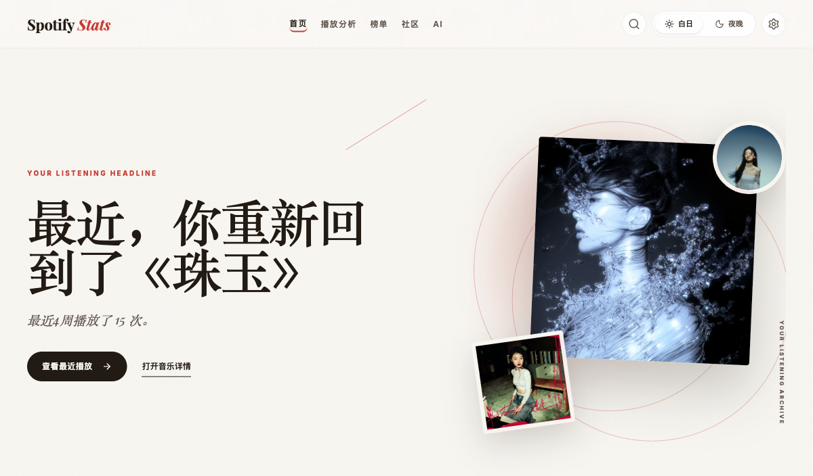
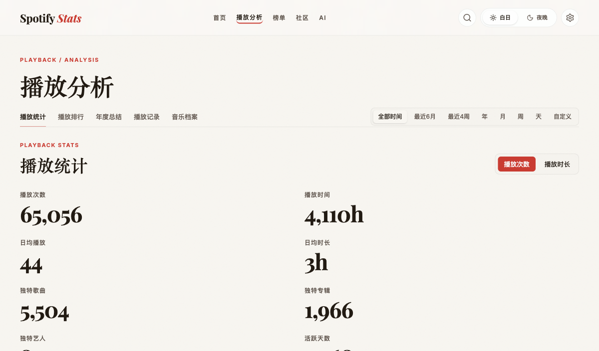
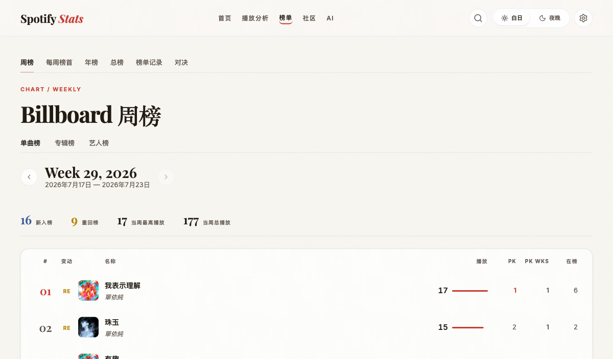
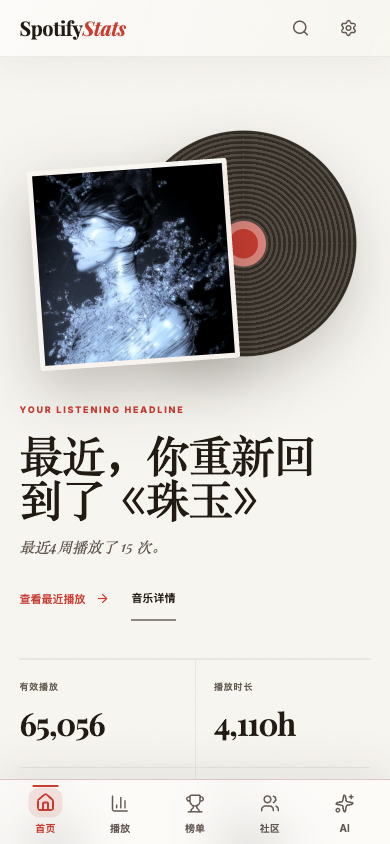

<div align="center">

# SpotifyStats

### 把听歌记录，变成你的个人音乐档案

用 Spotify 导出的数据，回看听歌习惯、发现旧爱，整理属于自己的年度总结和个人榜单。

<p>
  <a href="#你可以用它做什么">功能亮点</a> ·
  <a href="#产品画廊">界面预览</a> ·
  <a href="#开始使用">开始使用</a> ·
  <a href="docs/user-guide.md">使用指南</a>
</p>

[](LICENSE)

</div>

<p align="center">
  
</p>

<p align="center"><em>把“我听过什么”，整理成一份可以回看的个人音乐档案。</em></p>

SpotifyStats 是在自己设备上运行的单用户工具。下方截图使用演示数据展示界面，项目未提供公共在线体验站。

## 你可以用它做什么

| 功能 | 你能看到什么 |
| --- | --- |
| **个人音乐头版** | 最近的听歌动态、阶段亮点，以及值得再次播放的旧爱。 |
| **播放分析** | 听了多少、何时在听，哪些歌曲、专辑和艺人陪伴你最多。 |
| **个人 Billboard** | 根据自己的听歌记录生成周榜与年榜，追踪排名变化，比较歌曲和专辑的表现。 |
| **年度总结** | 回看一年的听歌时间线、重要纪录和完整榜单。 |
| **音乐档案** | 从收藏、歌单、搜索历史、播客等账号资料中认识自己的音乐习惯。 |
| **歌曲、专辑与艺人详情** | 查看它们在你听歌记录中的表现，探索相关作品和个人榜单成绩。 |
| **可选 AI 洞察** | 用自然语言提问，生成听歌报告和年度叙事；需要自行配置 AI 服务。 |

个人 Billboard 反映的是你自己的收听表现，与官方 Billboard 榜单无关。电脑和手机均有适配的浏览界面。

## 产品画廊

<table>
  <tr>
    <td width="50%" valign="top">
      
      <p align="center"><strong>播放统计</strong><br><sub>回看播放次数、收听时长和听歌趋势</sub></p>
    </td>
    <td width="50%" valign="top">
      
      <p align="center"><strong>个人 Billboard 周榜</strong><br><sub>追踪歌曲排名、入榜和回榜</sub></p>
    </td>
  </tr>
</table>

<p align="center">
  
</p>

## 开始使用

1. 在 [Spotify 隐私设置](https://www.spotify.com/account/privacy/) 请求播放历史与账号数据。
2. 按照[使用指南](docs/user-guide.md#安装与首次启动)安装并在自己的设备上启动。
3. 打开「设置 → 数据导入」，检查并导入数据，再开始浏览统计、榜单和音乐档案。

已完成安装后，可在项目目录运行：

```bash
python3 scripts/start_daily.py
```

在浏览器打开 <http://127.0.0.1:4173>。首次启动及更新后的操作见[使用指南](docs/user-guide.md)。

## 隐私与可选服务

- 播放历史和账号资料保存在你自己的运行设备上，请妥善保管。
- Spotify 连接用于补充音乐资料；AI 服务为可选配置，启用后会向所配置的服务发送生成回答或报告所需的数据。
- 分享自己的页面前，请先确认愿意公开哪些听歌信息。分享与访问设置见[使用指南](docs/user-guide.md#在手机或其他设备上查看)。

## 帮助与更多资料

- [使用指南与常见问题](docs/user-guide.md)
- [最近更新](docs/CHANGELOG.md)
- [完整文档入口](docs/README.md)
- [参与开发](CONTRIBUTING.md)

## License

[MIT](LICENSE)

SpotifyStats is not affiliated with or endorsed by Spotify.
